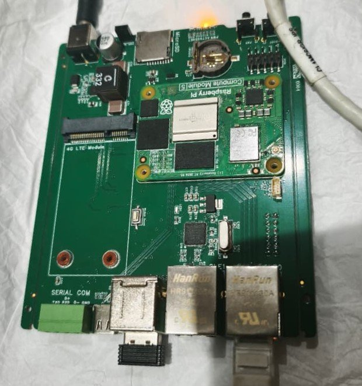
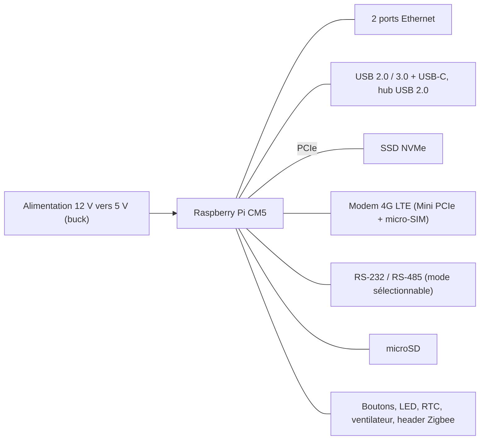
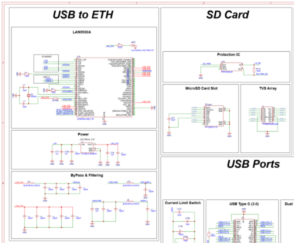
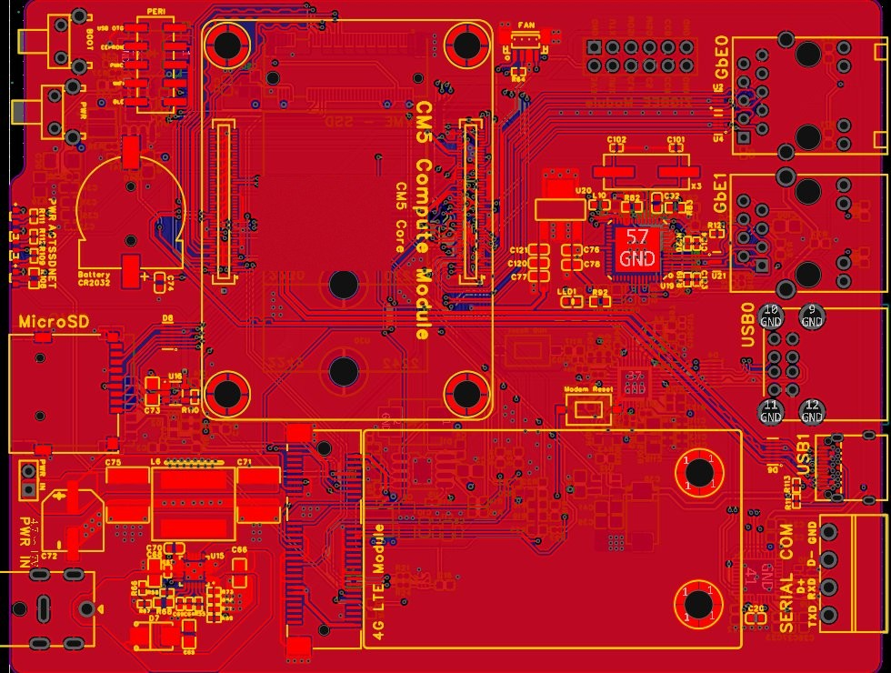
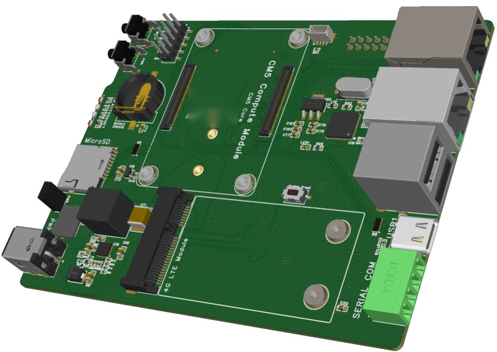

# Carte porteuse industrielle pour Raspberry Pi Compute Module 5

> *Industrial carrier board for the Raspberry Pi CM5, designed as an Edge-AI node for predictive maintenance. 6-layer PCB, controlled-impedance routing, 80 % validation rate on the prototype.*

## Contexte

Projet de fin d'études, OCP Maintenance Solutions, 2026. Carte porteuse pour un nœud d'Edge AI destiné à la maintenance prédictive : acquisition, stockage et traitement local des données, y compris en cas d'indisponibilité du réseau.

## Architecture

## Spécifications

- Raspberry Pi Compute Module 5 (CM5)
- Interfaces : double Ethernet, USB 2.0/3.0, RS-232/RS-485, modem 4G LTE, SSD NVMe, microSD
- Alimentation 12 V vers 5 V / 9 A max, pic estimé à 8,4 A sous 5 V
- Carte de 120 × 93 mm, PCB 6 couches sous EasyEDA Pro, empilage JLCPCB JLC06161H-3313 (1,54 mm)
- Paires différentielles à impédance contrôlée : USB 90 Ω, Ethernet 100 Ω, PCIe 85 Ω, RS-485 120 Ω

## Ma contribution

Cahier des charges, architecture matérielle et bilan de puissance ; sélection des composants (contraintes techniques, disponibilité, coût, plage de température) ; schéma et intégration des blocs USB, Ethernet, RS-232/RS-485, 4G LTE et NVMe ; routage du PCB.

## Résultats

- Schéma et routage finalisés, contrôles DRC sans erreur, fichiers de fabrication préparés pour JLCPCB
- Prototype intégré et testé, **taux de validation de 80 %**
- Refroidissement actif pour maîtriser la température en fonctionnement
- Modèle d'IA quantifié déployé en local : 5,7 tokens/s mesurés en inférence

### Schéma électronique (extrait)

### Routage du PCB 6 couches

### Vue 3D

## Remarque

Projet réalisé pour une entreprise : seuls des extraits sont présentés ici. Les fichiers de conception (projet EasyEDA, fichiers de fabrication) ne sont pas publiés.
